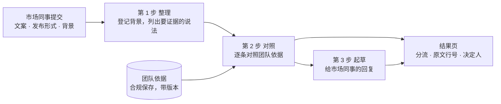

# 让合规团队自己搭审查流程（提交说明）

刘振鹏 · 2026-10-25 · 启动说明见 [README](../README.md) · 完整数字见 [验证记录](VALIDATION.md) · 提示词原文见 [AI 使用说明](AI_USAGE.md)

这份文档是 AltaLex 实习实战测试的提交说明。它按题目的五个部分写，依次是 A 业务理解、B 调研、C 方案与计划、D 功能与演示位置、E 验证与复盘。读完你会知道三件事。原型给谁用，解决什么问题。每个设计为什么这样做。验证跑出了什么结果，还有哪些没做到。

## 摘要

我动手写代码前，先用测试账号试了 AltaLex 现有的六个流程。我真实跑了谈判手册和尽调两个流程，还在对话框里试了一次营销文案审查。因为我把每个流程都走了一遍，所以我发现了三个业务痛点。

1. 现有流程都由平台写死，客户改不了。以港股公告审阅为例，系统先用问卷确认交易性质。问卷会问交易对手是不是关连人士、属于哪类交易、要不要股东批准和通函。然后用户上传公告，平台对照港交所的 CF007M 清单审阅。因为这份清单藏在平台后台，所以客户看不到它，也加不进自己公司的要求。
2. 团队规则没法保存，每次运行都要重新交。我跑 Negotiation Playbook 时，每次都得重新上传团队手册。我在对话框里试营销审查时，也得把审查政策和输出格式整段打进去。
3. 模型会自作主张，替团队补规则。我在尽调流程里只要 3 项检查，模型却先生成了 28 项。模型生成的谈判手册里，也多出了团队政策里没有的适用法律和退让条件。

AltaLex 的价格页把“定制流程”列为 Team 版单独谈价的服务。因为平台还没有自助配置功能，所以团队的审查方法要么锁在后台，要么每次重打。题目要求“让用户自己创建 Skill 和 Workflow”，正是为了补上这个缺口。

为了解决这些问题，我的原型把一套审查方法拆成三样东西存进系统。

- 技能（Skill）是一步工作的具体做法，告诉 AI 看什么和交什么。例如“把文案里需要证据的说法列出来，写明每条要什么证明”。
- 清单是团队自己的审查标准，界面上叫“团队依据”。每条写明最希望怎么写、可以退到哪一步、超出时由谁拍板。
- 流程（Workflow）把几个技能按顺序连起来，界面左边的导航叫“工作流”。前一步的结果会自动交给下一步。

合规团队只要搭好一次，市场同事以后每次只交文案就行。市场同事能直接拿回要改的句子、要补的材料和拍板人。因为每条结论都绑定了行号，所以点击结论就能跳回原文对应的那一行。

我选的主场景是新加坡金融机构的营销材料预审。我用 3 份真实的新加坡推广文案做了验证。它们分别是基金公司官网的 ETF 产品页、理财网站和基金公司的合作文章、银行官网的储蓄型保险页。这些材料的机构名都已去掉。

我还想检验这套搭法能不能换场景，所以又搭了港股交易公告审阅流程。我用了 AltaLex 港股公告流程对照的同一份 CF007M 清单。我照着 AltaLex 内置流程设了问卷，并在两份真实公告上运行。在一份已刊发的公告里，系统找出了清单要求但公告没写的内容。我另做了一个删掉两项披露的改动版，两次运行都找出了这两处缺漏。

因为时间和条件有限，所以我没有访谈真实客户，审查结论也没有请执业律师验收。

## 名词表

后文会反复用到下面这些词。它们在界面、文档和验证记录里的意思完全一致。

| 词 | 意思 |
|---|---|
| 技能（Skill） | 一步工作的做法。它写明这一步看哪些材料、做什么、交出什么，AI 照着做。技能可以带样例和检查点，保存前先试 |
| 流程（Workflow） | 把几个技能按顺序接起来，前一步的结果交给后一步。界面左边的导航叫“工作流”，就是流程 |
| 清单 | 团队自己的审查标准，一条一条写好，存一次就够，改动带版本。界面上叫“团队依据”。NDA 示例里的清单叫“底线” |
| 整理型、对照型、起草型 | 技能的三种类型。整理型只从材料里摘出和归类内容，不下结论。对照型拿清单一条一条对，每条附原文出处。起草型把前面的结果写成给人看的文字 |
| 材料性质 | 技能的每项输入都要标明性质，共四种：原文、背景、依据、上一步结果。技能编辑页的下拉里写作“要审的原文”“背景信息”“团队清单或底线”“上一步的结果”。只有原文能被引用。背景只帮模型了解情况。依据就是清单 |
| 首选立场、可接受退让 | 清单每条都写两档。首选立场是最希望的写法。可接受退让是没做到首选时，团队还能接受的写法 |
| 批准文本 | 团队事先审定过的句子。某条判为“不一致”时，系统直接用它作修改建议，不让 AI 起草 |
| 决定人 | 每条清单写明超出范围时由谁拍板，例如合规负责人、法务负责人或经办人 |
| 前置条件 | 必须先成立的大前提。营销清单的 R0 问产品能不能公开推广。R0 不成立时，结果直接标红 |

每份材料跑完一次流程，清单上的每一条都会得到一个结论，共有六种。界面上的分组名写得更完整一些，例如“符合依据”“与依据不一致”“需要补充材料”。

| 结论 | 意思 |
|---|---|
| 符合 | 原文做到了首选立场 |
| 在可接受退让内 | 没做到首选立场，但在可接受退让的范围内 |
| 不一致 | 首选立场和可接受退让都没做到，要改文案 |
| 需补材料 | 判断要用的证明还没交。这不算写错 |
| 本次不适用 | 这一条管不到这份材料，例如只管视频的条目遇到图文帖 |
| 需人工检查 | 系统自己的检查发现结论站不住，把这一条交给人核 |

结果页顶部有一个分流提示，告诉大家下一步由谁处理。因为分档由代码按清单计算，所以模型自己决定不了。

| 分流 | 颜色 | 意思 |
|---|---|---|
| 需要负责人决定 | 红色 | 出现下面任一情况：前置条件不成立，高严重度条目不一致或缺材料，模型漏答，适用范围待确认，有条目需人工检查 |
| 经办人按依据处理 | 灰色 | 只剩其余偏离、缺材料、退让和清单外的说法，经办人照清单就能处理 |
| 均在依据范围内 | 绿色 | 每条都在清单允许的范围内 |

## A. 业务理解

### 谁搭，谁用，谁拍板

产品里的用户分成三类角色，各自负责不同的环节。

| 角色 | 在金融机构里是谁 | 在产品里做什么 |
|---|---|---|
| 搭流程的人 | 合规或法务里维护审查清单的人 | 写技能，存清单，用样例试过再保存 |
| 用流程的人 | 市场同事、外部代理、合作博主 | 选流程，交本次文案、发布形式和推广背景 |
| 拍板的人 | 合规负责人 | 看结果，决定能不能发、能不能接受偏离，可以逐条采纳或改判 |

我这样划分角色，是因为有两条行业依据。

1. 新加坡金融管理局（MAS）要求金融机构对每条数字广告负责。因为网红自己加的话也算在机构头上（MAS 数字广告指引第 2.40 段），所以审查标准必须由机构的合规团队来定。
2. 同类产品也都采用“少数人搭、多数人用”的模式。例如 Ironclad 规定只有管理员才能建谈判手册，IntelligenceBank 的客户自己也只能加一种规则。

### 他们现在怎么做，卡在哪里

因为我没有机会访谈真实客户，所以下面的五个痛点都来自公开调查、监管处罚和法院判决，出处列在 B 节末尾。

1. 审稿慢，来回修改的轮数多。Saifr 在 2024 年调查了 59 位美国金融机构的风控合规负责人。调查显示一份推广材料审一次，多数要 4 到 5 个工作日。合规人员估计每份要来回 3 到 4 轮。规模较大的部门里，市场负责人估计要 6 到 10 轮。IntelligenceBank 在 2022 年调查了 550 多名大企业的市场、法务和合规人员。其中 79% 的市场人员说步骤太多、周期太长、批得太晚。这两份调查都由厂商赞助，样本在美国、英国和澳大利亚，新加坡还没有公开的同类数据。
2. 审稿标准因人而异，缺少统一指引。在同一份 IntelligenceBank 调查里，76% 的市场人员反映缺少清楚的指引和一致的反馈。因为审稿人之间意见不一，所以市场人员觉得判断过于主观。
3. 宣传说法缺证明，是监管开罚单的高发区。英国金融行为监管局（FCA）在 2024 年处罚了 London Capital & Finance 的合规官。因为这位合规官没拿到证据就签批了几百份推广材料，所以被罚款并禁业。美国证券交易委员会（SEC）同年也对 9 家投资顾问开了罚单，原因之一就是宣传的奖项和说法拿不出证明。
4. 新加坡监管规则刚收紧，要求审稿必须留记录。MAS 数字广告指引在 2026 年 3 月 25 日生效，要求按广告规例保留审批记录（第 2.37 段）。2026 年 5 月，MAS 又把需要审批的范围扩大到非产品广告和介绍人发布的广告。因为旧广告不必按新规重审，所以新旧两版规则同时有效，合规团队必须说清每条广告按哪一版审。
5. 律师必须亲自核实 AI 输出，自己承担责任。新加坡律政部在 2026 年 3 月发布了生成式 AI 指南。指南要求由合格人员核实 AI 输出，并建议使用能给出处的工具。因为有律师在办案时引用了 AI 编造的判例，所以新加坡法院在 2025 年和 2026 年两次判律师个人赔付。

因为存在这五个痛点，所以审查流程必须做到四件事。

1. 团队标准存进系统，每次都照同一套标准审。
2. 把“文案写错了”和“说法缺证明”分开处理。
3. 每条结论都能追回原文、清单条目和当时的清单版本。
4. 最终拍板权留给人类负责人。

### 自助创建带来什么

自助创建功能给客户和 AltaLex 都能带来直接的业务价值。

- 对客户来说，团队把审查清单写好一次，每个人每次都能照着用。因为改清单要填修改说明和批准人，所以遇到监管检查时能交代清楚依据版本。新人照着流程提示就能交出合格材料，老同事也不用一遍遍带。
- 对 AltaLex 来说，“定制流程”现在要靠销售和交付团队支撑。有了自助创建功能，客户自己就能配流程，加新场景也不用等平台排期。创始人吉芸在 2026 年 5 月的 ALB 采访里说过，AI 负责整理事实和推理，最终决定留给专业用户。原型的分工和这个判断一致。
- 产品上线后，团队可以用四个指标来衡量效果。这些指标目前还没有实测。
  1. 市场同事第一次提交时材料齐全的比例。
  2. 补件来回的轮数。
  3. 负责人找到原文出处花的时间。
  4. 系统判错却没被拦下的条数。

### 推进时我先做的五个判断

我按优先级列出了五个需要业务方确认的问题。下表写明了每个问题影响什么决策、我先按什么假设推进，以及它会不会卡住开发。

| 要确认的问题 | 影响什么决策 | 我先做的判断和依据 | 能否先推进 |
|---|---|---|---|
| 1. 首批客户是谁，谁搭、谁交、谁拍板？ | 角色和权限设计。如果首批是律所，搭流程的变成律师，提交的是客户，要加客户之间的隔离和计费 | 金融机构的合规团队。合规搭，市场交，合规负责人拍板。MAS 要求机构对每条广告负责，同类产品都是少数人搭、多数人用 | 原型可以推进，上线前要确认 |
| 2. 第一个场景和适用法域是什么？ | 清单内容和示例。法域写在清单里，不在代码里。换成香港，就换一份香港的清单 | 新加坡金融推广的发布前预审。规则公开，2026 年刚收紧，量大 | 可以推进。清单内容上线前请律师确认 |
| 3. 团队有没有成文的审查清单？ | 客户怎么上手。如果没有，要先帮团队从过去的审稿意见里整理出清单 | 有，在 Word 或 PDF 里。同类产品都从导入现有手册开始 | 可以推进 |
| 4. 漏报和多报，客户更怕哪个？ | 复核力度。如果客户更在意速度，就放宽复核，少转给人 | 漏报代价更大。漏掉一条，广告就直接发出去了。多报只是多改一句 | 可以推进，复核力度由客户定 |
| 5. 材料能不能发给外部模型？ | 模型部署。未发布的稿子和背景属于保密信息。不能外发就换本机或私有部署的模型，原型改环境变量即可（已支持本机 Ollama） | 材料可以发给外部模型。推广发布后本来就公开 | 演示可以推进。接真实客户材料前必须确认 |

这里的“漏报”是指把真有问题的放过去，“多报”是指把没问题的判成有问题。

这五个问题里，会卡住后续开发的是第 1 条和第 5 条。因为做多人权限要等第 1 条的答案，接真实客户材料要等第 5 条的答案。其余三条的判断即使错了，我也只要改清单和配置，不用动代码。

## B. 调研

我围绕五个问题做了前期调研，并把每个调研结论都落到了产品设计上。

| 问题 | 看了什么 | 得出什么 | 产品里改了什么 |
|---|---|---|---|
| AltaLex 现在怎么做？ | 测试账号里的六个流程、对话、Library、Project（亲自使用） | 流程和清单由平台预置。团队规则每次重新上传或手打。模型会补规则 | 清单保存一次、带版本。结果里分开标“团队批准的句子”和“AI 起草的句子” |
| 同行怎样让团队写下自己的标准？ | 合同谈判手册类产品（Spellbook、Ironclad、LegalOn、Juro 等）和营销预审产品（IntelligenceBank、Warrant、Norm Ai）的公开文档 | “首选写法、可接受退让、批准过的句子、偏离时找谁、按情形适用”已是行业通行的结构 | 清单按这几样拆成字段 |
| 营销合规的规则从哪来？ | MAS 数字广告指引（FSG-03）、集合投资计划广告规例、ASAS 社交媒体附件 B | 披露要求随发布形式变。每一帖单独看也不能误导。基金广告有必须写的声明 | 提交时选发布形式，代码按它筛选条目。清单加入“整体印象”和“基金必备声明” |
| 从业者卡在哪？ | Saifr、IntelligenceBank 的行业调查。FCA、SEC、FINRA 的处罚。MAS 征询意见回复 | 审得慢，标准因人而异，缺证明常被处罚，监管要审批记录 | “需补材料”单独成为一种结论。每次运行保存清单版本和修改记录 |
| 法律行业对 AI 输出有什么要求？ | 新加坡律政部生成式 AI 指南、新加坡法院两份判决 | 使用者必须核实，责任不转给工具 | 每条结论标出原文行号和清单条目。AI 起草的句子必须标明来源 |

因为我做了竞品调研，所以我推翻了自己原先设想的三个卖点。营销预审的同行已经做出了按发布形式筛选规则、结论回指原文和批准文本库。因为同行已经有了这三样东西，所以它们不能再算我的差异点。我重新核对之后，确认站得住的差异点有三个。

1. 系统把“需补材料”单独列为一种结论，并自动汇总成给提交人的补件清单。在我查到的公开资料里，同行都把缺证明和写错了混在一起记成“风险”。
2. 客户团队能自己维护完整的结构化清单，先拿样例试跑，确认无误再保存。IntelligenceBank 的客户只能加一种规则，而且保存前不能测试。
3. 每条适用的规则在结果里恰好出现一次，“还不确定适不适用”的条目也会列出来。所以合规负责人一眼就能看出哪些查过了、哪些还没查。

受时间和条件限制，我的调研还有四处信息缺乏验证。

1. 我没有做真实客户访谈。
2. 竞品分析只参考了网上的公开资料。
3. 引用的痛点调查都由厂商赞助，且样本不在新加坡。
4. 清单里引用的监管段落，还要请执业律师复核。

### 主要来源

全部来源和逐条摘录都保存在 `docs/research/` 和 `audit/practitioner_sources.md` 里。下面列出正文直接用到的资料链接。

- AltaLex 的[价格页](https://alta-lex.ai/pricing)。测试账号实测记录在 `docs/RESEARCH_NOTES.md`。创始人观点出自 ALB 2026-05-25 对吉芸的采访。
- 新加坡监管
  - [MAS 数字广告指引](https://www.mas.gov.sg/regulation/guidelines/guidelines-on-standards-of-conduct-for-digital-advertising-activities)
  - [MAS 征询意见回复](https://www.mas.gov.sg/-/media/mas/regulations-and-financial-stability/regulations-guidance-and-licensing/financial-advisers/consultation-paper/response-to-guidelines-on-standards-of-conduct-for-digital-advertising-activities.pdf)
  - [Baker McKenzie 对指引的解读](https://www.bakermckenzie.com/en/insight/publications/alerts/2025/10/singapore-mas-guidance-on-digital-finance-ads)
  - [ASAS 附件 B](https://asas.org.sg/Portals/0/Annex%20B%20-%20Guidance%20notes%20for%20Interactive%20Marketing%20Communication%20and%20Social%20Media.pdf)
  - 2026 年 5 月扩大审批范围一事，依据是 MAS 2026-05-22 对广告规例修订的回复，并经 Allen & Gledhill 的解读核对。原文链接没有存档。
- 律师使用 AI
  - [新加坡律政部生成式 AI 指南](https://www.mlaw.gov.sg/files/Final_Ver__Guide_for_using_Generative_AI_in_the_Legal_Sector.pdf)
  - [[2025] SGHCR 33](https://www.elitigation.sg/gd/s/2025_SGHCR_33)
  - [[2026] SGHC 49](https://www.elitigation.sg/gd/s/2026_SGHC_49)
- 行业痛点
  - Saifr 调查（[Saifr 博客](https://saifr.ai/blog/compliance-concerns-workloads-knowledge-gaps-and-separate-systems)、[FinTech Global 报道](https://fintech.global/2024/06/27/how-compliance-reviews-are-shaping-financial-marketing-strategies/)）
  - [IntelligenceBank 白皮书](https://intelligencebank.com/wp-content/uploads/2024/09/IntelligenceBank-How-To-Resolve-the-Divide-Between-Marketing-and-Compliance-Teams.pdf)
  - [FCA 对 London Capital & Finance 合规官的处罚](https://www.fca.org.uk/news/press-releases/fca-bans-and-fines-floris-jakobus-huisamen-over-london-capital-finance-plc-financial-promotions)
  - [SEC 对 9 家投资顾问的处罚](https://www.sec.gov/newsroom/press-releases/2024-121)
- 竞品
  - [IntelligenceBank 规则类型](https://help.intelligencebank.com/support/solutions/articles/51000504437-content-risk-review-rule-types)
  - [Ironclad AI Playbooks](https://support.ironcladapp.com/hc/en-us/articles/24948981301143-Create-Ironclad-AI-Playbooks-in-Workflow-Designer)
  - [Spellbook Playbooks](https://help.spellbook.legal/en/articles/9926250-playbooks-overview)
  - [LegalOn Playbooks](https://legalontech.com/contract-playbooks)
  - [Juro AI 审阅手册](https://intercom.help/juro/en/articles/16019964-setting-up-ai-review-playbooks)
  - [Warrant 披露库](https://www.hellowarrant.com/platform/disclosure-library)
  - [Norm Ai](https://www.norm.ai/resources/what-is-a-regulatory-ai-agent)
- 港股清单。[港交所 CF007M](https://www.hkex.com.hk/-/media/HKEX-Market/Listing/Rules-and-Guidance/Forms/Equity-Securities-Issuers/cf007m.docx)。两份公告的下载地址和文件指纹在 `examples/hk_announcement_sources_2026-10-24.md`。

## C. 方案与计划

### 为什么先做营销预审

我选择新加坡金融机构的营销材料预审作为主场景，有以下五个原因。

1. 机构的审阅量大，而且每条广告都要在发布前审完。因为 MAS 要求金融机构对每条数字广告负责，网红和分销伙伴发的也算，所以合规团队得一条条审。
2. 新加坡规则在 2026 年刚收紧，新旧两版同时有效。所以合规团队需要把监管解读写成清单，每次照同一套标准审，并记下按哪一版审。
3. 金融营销的监管规则全部公开，适合写成清单逐条检查。因为规则明确，所以我能拿事先写好的标准答案客观检验系统判得准不准。
4. 这个场景最能体现合规律师的基本功，就是分开“文案写错了”和“说法缺证明”。因为说法缺证明正是监管开罚单的高发区，所以分开处理很有价值。
5. AltaLex 在港股公告审阅上已经用了“先问清事实，再按清单审文件”的做法。因为营销预审用的是同一个骨架，所以它可以成为平台目录里的下一个高频场景。

### 同一套搭法，换一份清单就能用到别处

营销预审、港股公告审阅和合同谈判，它们的审阅步骤其实是一样的。

1. 登记基本事实，确认前提条件。
2. 拿团队标准逐条对照，分开缺证明和写错了。
3. 起草给提交人或对方的修改回复。
4. 交由人类负责人最终拍板。

因为步骤相同，所以原型只设计了三种通用的技能类型。整理型技能从材料里摘录归类，对照型技能拿清单逐条比对，起草型技能根据前面的结果写回复。代码里没有任何为营销场景写死的特殊逻辑。

营销预审虽然有三处特殊要求，但它们也都做成了清单里的通用配置。

| 营销预审的要求 | 在清单里怎么配 |
|---|---|
| 规则随发布形式变化 | 条目里配置适用条件，比如“仅当发布形式是视频” |
| “产品能不能公开推广”这个大前提 | 把对应条目勾选为前置条件。前提不成立时，结果直接标红，回复只追问这一件事，其余条目照常检查留档 |
| 整篇帖子的整体印象是否误导 | 作为一条单独的清单条目放进去 |

为了检验这套机制能不能跨场景复用，我用同一个对照技能又搭了两个流程。

- 第一个是港股交易公告审阅。我载入港交所公开的 CF007M 清单，挑出须予披露交易和关连交易适用的 15 条。因为 AltaLex 内置的港股公告流程也对照这份清单，所以我照着内置流程设了问卷。“交易对手是不是关连人士”和“交易属于哪一类”这两个答案，决定了哪些条目适用。这个流程在 BFB Health 和 AEON Stores 两份 2026 年刊发的真实公告上跑通，结果见 E 节。
- 第二个是 NDA 对照我方底线。这里换成了一份合同谈判底线清单，系统会按我方在合同里的角色自动筛选适用条目。

### 两类用户怎么用

搭流程的合规同事只要按顺序操作四步。

1. 新建技能，选好技能类型，给每项输入标明材料性质。因为只有标为“原文”的材料能被引用，所以标为“背景”的材料只帮模型了解上下文。
2. 写明这一步的具体做法，并设好预期检查点。检查点写的是结果里应该出现什么、不应该出现什么。合规同事拿样例试跑一次，等检查点全部通过再保存。
3. 新建流程，把建好的技能按顺序加进去。系统会按输入的名称和性质预先接好每一步的输入来源，并标上“系统预选，请确认”，最后由人核定。
4. 载入已有的清单，或者现场新写一份清单保存。

交材料的市场同事只要按顺序操作三步。

1. 选好审查流程，提交本次文案、发布形式和推广背景。
2. 查看结果页顶部的分流提示。提示分三档写明下一步由谁处理，即“需要负责人决定”（红色）、“经办人按依据处理”（灰色）和“均在依据范围内”（绿色）。因为分档由代码按清单计算，所以模型决定不了。
3. 逐条核对原文定位和审查依据，然后一键复制给市场同事的修改回复，或者导出内部审阅表存档。

### 做了什么，暂时不做什么

为了在规定时间内交付可靠的原型，我明确划分了本次实现和暂不实现的功能边界。

| 做了 | 暂时不做，以及原因 |
|---|---|
| 三类技能、材料性质、样例试用和预期检查点 | 多人权限和发布审批。要先确认客户内部谁搭、谁交、谁批 |
| 结构化清单，含前置条件、适用条件、批准过的句子、决定人、修改记录 | 识别图片和视频。同行也只做到语音转文字，文字稿判断不了最终画面，所以先列为“需补材料” |
| 逐条对照、引文核对、两道自查、原文行号、三档分流、人工采纳或改判 | PDF 页码定位。它需要第三方库，评审的电脑未必装得上 |
| 给市场同事的回复、内部审阅表（Word 能打开） | 改稿后只复审改动的部分。排在下一步 |
| 改清单后重跑并对比，刷新后配置和记录都在 | 从历史审稿里自动学规则。这样会把个案当成政策 |

### 代码和模型怎么分工

上面这张图从左往右读。市场同事提交材料后，第 1 步整理事实，第 2 步拿清单对照，第 3 步起草回复，最后在结果页汇总。图里的“团队依据”就是清单。

代码和模型的分工只遵循一条原则。因为合规审查要求结果确定且事后能复查，所以确定性环节全交给代码，需要读懂自然语言的环节才交给模型。

| 代码负责 | 模型负责 |
|---|---|
| 按发布形式决定哪些条目适用。前置条件不成立时标红 | 判断原文是否做到某一条，以及每个退让条件是否满足 |
| 检查每条是否都回答了，漏了就补一条“模型未返回” | 引用哪一句原文，为什么 |
| 核对引文是否逐字出自原文。出自背景的标出来 | 起草修改后的句子 |
| 结论和逐项回答对不上时，改成“需人工检查” | 列出清单之外可能有风险的说法 |
| 严重程度、决定人、批准过的句子、分流档位 | 起草给市场同事的回复 |

### 计划和实际

我动手写代码前，先写了一页开发计划。计划包括用户流程、首版范围、技术方案、实施步骤、预估时间、主要风险和验证方式。下表把当时的预估计划和实际执行情况放在一起对照。

| 步骤 | 预估 | 实际 | 主要风险 | 怎么验证 |
|---|---|---|---|---|
| 定接口和样例 | 约 30 分钟 | 完成 | 前后端理解不一致 | 接口文档和服务端测试 |
| 技能保存与试用、流程配置、存储 | 1 到 2 小时 | 完成。后来加入技能类型、材料性质和预期检查点 | 不懂技术的用户看不懂“材料从哪来” | 按材料性质预选来源并标“请确认”。前端测试 |
| 运行器、模型接入、快照、异常 | 1 到 2 小时 | 完成。后来改成逐条对照，并接入 DeepSeek | 前一步结果没完整传到后一步。小模型漏条、改编号、编造引文 | 处理详情逐字段比对。代码补漏、校验编号、核对引文 |
| 完整流程、真实模型、失败测试、交付 | 1 到 2 小时 | 先跑通第一轮，最后按演示路线完整彩排 | 只在开发时用的样例上看起来对 | 盲测集，答案先写好再运行 |

### 计划改了哪些地方，为什么

在开发和测试过程中，我根据实测结果修改了六处原定计划。

1. 我把原文和背景拆成两份输入，规定只有原文能被引用。因为第一版把两者混在一起，结果模型把背景里的“公司已付费委托”当成文案原句引了出来。我加强提示词重跑还是错，所以改从输入结构上给材料标性质。
2. 我把一次提交整份清单，改成每次只拿一条规则问模型，再由代码补漏和核对编号。因为把整份清单塞给小模型时，它经常漏掉整条规则或改编号。在盲测材料上，它整条漏掉 6 次，编号对不上 1 次。
3. 我撤回了“把每条判断拆成是非小题”的做法，改成让模型逐项回答每个退让条件，再由代码检查回答和结论是否一致。因为实测下来，拆成是非小题后的准确率反而更差。
4. 我把按字段名自动串联上下游技能，改成按材料性质预选，并标上“请确认”交给人核定。因为独立审查指出，单纯按字段名对接没有业务依据。
5. 我把营销和 NDA 两个示例里几乎一样的审阅技能，合并成了一个通用对照技能。因为如果每个流程各写一份，就说明技能根本没有做到复用。
6. 我按资深合规审阅人的工作顺序重做了流程。新顺序先看大前提，再列需要证据的说法，接着逐条对照清单、看整体印象，最后写处理意见。因为最初的技能只是简单“按清单对一下”，不像真实审阅人在干活。

## D. 功能与演示位置

下表列出了题目 D 部分的每一项功能要求，以及它们在产品界面和演示视频里的具体位置。

| 题目要求 | 产品里在哪 | 演示怎么做 |
|---|---|---|
| 自建 Skill，包括说明、输入、输出、样例测试 | 技能 → 创建技能。一页四段，依次是这个技能做什么、每次需要哪些材料、交出什么结果、用样例试一下 | 先打开已有的“受理与声明清单”讲清四段。再在营销预审流程里现场新建第 3 步技能“审阅意见回复与内部备注”，用样例试用，检查点全部命中后保存 |
| 组合 Skill，前一步结果传给后一步 | 创建流程。依次填名称和用途、每次提交的材料、按顺序添加技能。系统按输入的名称和性质预选来源，标“系统预选，请确认”。可以载入已保存的清单 | 打开已有的两步流程讲清顺序，现场把新技能加成第 3 步，保存为第 2 版，按 F5 刷新后仍在。处理详情显示“已核对：内容完全一致” |
| 执行，显示状态、每步结果和最终结果 | 运行时显示“正在逐条核对团队依据 x/12”。结果页有“审查意见”和“处理详情”两个标签，三步流程多一个第 3 步结果的标签 | 提交真实推广文案。点原文里标色的句子跳到对应条目，再看第 3 步写好的回复 |
| 修改后重跑，刷新后仍可用 | 编辑依据（要填修改说明和批准人）。结果页“与上次运行相比” | 给 R6 加批准过的句子。重跑后，“与上次运行相比”显示 R6 的建议文字换成了团队批准文本 |
| 缺输入、模型失败 | 提交页必填校验。模型报错用中文写明原因 | 视频里不选发布形式直接运行，页面提示缺哪一项。视频没有现场演示模型报错，`evidence/failure_case_http401_2026-10-24.json` 保存了真实的 HTTP 401 运行记录，评审也可以运行 `scripts/failure_demo.sh` 在 8766 端口复现 |
| 真实模型，密钥用环境变量 | `.env.example` 写好 DeepSeek、本机 Ollama、模拟三种配置 | 演示用 deepseek-flash |
| 不能写死场景 | 同一个对照技能服务营销、港股公告、NDA 三个流程 | 技能卡上显示它被几个流程共用。打开港股公告的结果 |

## E. 验证与复盘

### 怎么读验证结果

我用预先锁定的标准答案来检验原型的审查质量。每份材料跑一遍流程，清单上的每一条都会得到一个结论，比如“这条做到了”“这条没做到”或“缺证明，判断不了”。这样一个结论，我叫它“一个判断”。港股公告清单有 15 条，3 份公告各跑 2 次，一共就是 15 × 3 × 2 = 90 个判断。

因为我要避免事后对着结果改答案，所以所有测试材料的标准答案都在运行前写好并锁定。盲测集、真实营销材料和港股公告的答案，都由另一个没参与设计的 AI 代理编写。开发期测试集的答案，是我在开发前写好的。跑完以后，我把每个判断和标准答案对一遍，结果分成三种。

| 结果 | 意思 |
|---|---|
| 判对 | 和标准答案一样 |
| 判错但交给了人看 | 结论错了或拿不准，系统在这条上标了“需人工检查”。负责人会去核一眼，错误不会被当成定论发出去，代价是多花一点时间 |
| 判错且没有提示 | 错的结论和对的看起来一样，用户会照单全收。这一种最危险，单独数出来 |

我举一个真实的例子来说明第三种情况。示例帖子写着“年度收益最高可达 8%”。清单的 R11 要求“过往业绩、比较、获奖与排名要有出处”。有两次运行，模型把这个 8% 当成了过往业绩，判为“需补材料”，也没有标“需人工检查”。如果照着发回去，市场同事就会去找一份并不需要的出处。这属于“判错且没有提示”，而且是把没问题判成有问题的“多报”。

### 用了哪几组测试材料

我一共准备了四组测试材料，它们的标准答案都在运行前写好并锁定。

| 名称 | 是什么 | 谁写的 | 用来检验什么 |
|---|---|---|---|
| 开发期测试集 | 6 份虚构的营销帖子。5 份配旧版 5 条规则，1 份专门测试换成另一套 2 条规则，所以每跑一次是 27 个判断 | 我在开发前写好 | 比较不同的引擎和模型 |
| 盲测集 | 6 份新的虚构帖子，配新版 12 条清单 | 由另一个 AI 代理写。它没参与设计清单，也没看过任何模型输出。文件指纹已记录 | 检验新清单在没见过的材料上判得准不准 |
| 真实营销材料 | 3 份真实的新加坡推广文案（基金公司 ETF 产品页、合作文章、银行储蓄型保险页），已去掉机构名 | 另一个代理先到 MAS 和招股说明书核对产品事实，再写答案 | 检验真实文案上的表现 |
| 港股真实公告 | BFB Health 和 AEON Stores 2026 年刊发的两份公告，加一份从 BFB 公告里删掉两项披露的改动版，配港交所 CF007M 清单 15 条 | 另一个代理在运行前写好答案 | 检验同一套搭法换一个法律场景后的表现 |

在下面的记录里，“flash”和“v4-pro”是 DeepSeek 的两个模型，“本机 4B”是我在笔记本上运行的 qwen3:4b 小模型。

### 结果

<!-- TABLE:E_TABLE -->
| 测试 | 模型 | 判断数 | 判对 | 判错但交给了人看 | 判错且没有提示 |
|---|---|---|---|---|---|
| 两个示例（营销 12 条；NDA 两种角色各 11 条；各跑 2 次） | flash | 68 | 65 | 3 | 0 |
| 两个示例（营销 12 条；NDA 两种角色各 11 条；各跑 2 次） | v4-pro | 68 | 66 | 2 | 0 |
| 开发期测试集，律师写法 | flash | 54 | 51 | 1 | 2 |
| 开发期测试集，泛化写法 | flash | 54 | 52 | 0 | 2 |
| 开发期测试集，律师写法 | v4-pro | 54 | 52 | 0 | 2 |
| 开发期测试集，新引擎，跑 1 次 | 本机 4B | 27 | 21 | 6 | 0 |
| 开发期测试集，旧引擎，跑 1 次 | 本机 4B | 27 | 18 | 未分类 | 未分类 |
| 盲测集，12 条清单，完整流程 | flash | 144 | 133 | 7 | 4 |
| 盲测集，跑 1 次 | v4-pro | 72 | 68 | 4 | 0 |
| 两个示例，技能说明改写后复跑 | flash | 68 | 63 | 3 | 2 |
| 盲测集，技能说明改写后复跑 | flash | 144 | 132 | 8 | 4 |
| 真实营销材料：3 份新加坡推广，各跑 2 次 | flash | 72 | 64 | 5 | 3 |
| 港股真实公告：2 份公告加 1 份改动版，各跑 2 次 | flash | 90 | 77 | 8 | 5 |
<!-- /TABLE:E_TABLE -->

从上面的测试结果里，我总结出五个发现。

1. 代码检查机制让小模型的表现明显变好。我用同一个本机 4B 小模型和同一组开发期测试集做了对比。旧引擎是早期的两步流程，27 个判断里判对 18 个（记录在 `audit/heldout_eval_v2_2026-10-23/`）。新引擎改成每条单独问、由代码核对、再做反向复核，结果 27 个里判对 21 个，判错的 6 个全部交给了人。这两组都只跑了 1 次。因为模型没变，所以提升来自检查机制。反向复核是指模型判某条没问题时，系统换一种问法再问一次“原文哪里没做到”，一旦找到差距就交给人。
2. 盲测集上没有出现一例漏报。flash 在 144 个判断里判对 133 个，4 个判错且没有提示的全是多报。v4-pro 跑了 1 次，在 72 个判断里判对 68 个，没有提示的错误为 0。
3. 把技能说明改得更好读之后，输出结果仍然稳定。我改写了两个技能的说明，但没动清单规则，然后用 flash 重跑盲测集。结果是 132 个判对、4 个没有提示，而且还是同样的 4 处多报。
4. 3 份真实的新加坡推广文案一共产生 72 个判断，其中判对 64 个，5 个交给了人看，3 个判错且没有提示。
   - 在基金公司的 ETF 产品页上，系统抓到了 “Earn stable dividends”（稳定派息）暗示收益稳定，并要求补 “The world's first APAC Financials ETF”（全球第一只亚太金融 ETF）的出处。
   - 在银行的储蓄型保险页上，系统抓到了只写简称的发布主体，也认出这不是基金，所以不必写基金必备声明。
   - 没有提示的 3 个错误里，有 2 个是多报，1 个是漏报。这个漏报出在合作文章上。对于作者是否持牌，网站只在页脚泛泛提了一句。标准答案是“需补材料”，但有一次运行判成了“符合”。写答案的代理事先就标出，R9 在“公司网站上署名作者”的情形下存在歧义。
5. 港股公告一共产生 90 个判断，其中判对 77 个，8 个交给了人看，5 个判错且没有提示，而且这 5 个全是多报。
   - 我从 BFB 公告里删掉了两项披露，一项是顶部的港交所免责声明，一项是代价是怎么定的。系统在两次运行里都把它们找了出来。
   - 在两份原样刊发的公告里，系统指出的问题和标准答案一致。BFB 的买方只写了“一位个人”，没写身份和背景，标的公司也只给了收入和经营亏损。AEON 没写最终实益拥有人的主要业务，原收购成本也需要补材料。因为这些结论是按我搭的示例清单得出的，所以不代表原公告违反上市规则。
   - 5 个多报里，有 4 个出在同一条规则。公告顶部的免责声明其实一字不差，系统却判成了不一致。因为这条清单的出处说明里提到了另一个版本的写法，所以把模型带偏了。

### 原型做到了什么

营销预审场景有三个核心痛点，分别是团队标准每次要重交、缺证明和写错了混在一起、审查意见追不回出处。我的原型解决了这三个痛点的核心部分。

- 清单保存一次就能反复用，而且自带版本记录。改动清单必须写说明和批准人，重跑后还能直接看到哪条变了。
- 在 ETF 产品页上，系统把“稳定派息”判为不一致，把“全球第一只”判为需补材料。两类问题被清楚分开，每条都能点回原文那一行。
- 至于它能帮团队少跑几轮补件、省下多少时间，还要等真实团队用过才知道。这也是我下一步最优先要做的第一件事。

| 状态 | 内容 |
|---|---|
| 已实现，用真实模型跑通 | 自建技能并试用、组流程、执行、修改后重跑、刷新后配置和记录仍在、缺输入和模型失败的提示。DeepSeek flash、v4-pro 和本机 qwen3:4b 都真实调用过 |
| 示例或模拟 | 营销清单和 NDA 底线是参照公开文件写的虚构公司政策。开发期测试集和盲测集的帖子是虚构的。模拟模式只用于自动测试，不生成审阅意见 |
| 还没做 | 多人权限和发布审批。图片、视频和 PDF 版式。改稿后只复审改动的部分。导入现有的 Word 清单 |

产品提供了五项机制，帮助合规律师检查 AI 的输出。

1. 每条结论都标出原文行号。用户点“在原文中定位”，原句就会高亮。代码还会逐字核对引文，如果引文出自背景就会专门标出来。
2. 建议文字分开标明“团队批准文本”和“AI 起草”。凡是 AI 起草的句子，都要等律师核对后才能发出。
3. 只要出现结论和逐项回答对不上、模型漏答、或者模型说“符合”但反向复核找到差距，系统都会标成“需人工检查”。
4. 决定人和分流档位由代码按清单计算，模型不能替负责人做决定。
5. 每次运行都会保存当时的清单版本。“与上次运行相比”会分开显示本次修改的条目和模型波动。

### 没解决的问题

在虚构的盲测集和港股公告上，剩下的“判错且没有提示”全是多报。在真实营销材料上，则出现了 1 处漏报。我分析下来，原因有三层。

1. 反向复核目前只检查对提交人有利的结论，也就是“符合”和“在可接受退让内”。因为“不一致”和“需补材料”目前不做反向复核，所以多报就漏了过去。这是我有意的取舍。因为合规审查里漏报的代价远大于多报，所以我把复核先用在防漏报上。
2. 错误集中在两条规则的写法上。在开发期测试集里，所有模型在 R2 上都错在同一处。在盲测集里，R11 反复把“最后名额”和“最高可达 8%”当成过往业绩。解决的办法是改写这两条规则，改完另写一组全新的盲测材料来检验，不能拿旧材料打分。港股清单的免责声明那一条也一样，需要删掉出处说明里干扰模型的另一个版本。
3. 清单本身有没想到的业务情形。真实合作文章的作者署名在公司网站上。因为 R9 只写了“个人账号”和“机构自有账号”两种情况，所以模型在中间地带判成了“符合”。这类漏报要靠在真实材料上多跑，把遇到的新情形补进清单。

### 下一步最优先的三件事

如果继续开发这个产品，我最优先会做下面三件事。

1. 我会用真实的历史审稿记录做回放测试。我想请一家金融机构的合规团队拿出过去审过的 20 份推广材料和当时的审稿意见。我用原型重跑并逐条比对，算出首轮意见覆盖了多少问题、能省掉几轮补件来回。因为这是检验产品真实价值最直接的指标，所以它是判断产品值不值得做下去的最快办法。
2. 我会支持直接导入现有的 Word 审查清单。AI 先把文档拆成结构化条目，合规律师逐条对照原文确认后再发布。因为没有这一步，客户第一天就得从空白开始手写清单，很难真正用起来。
3. 我会实现改稿后只复审受影响的条目，并记录每一版文案按哪一版清单审。因为调研显示一份推广往往要来回改好几轮，而且 MAS 新旧两版规则同时有效，所以增量复审和版本留痕是落地的刚需。
